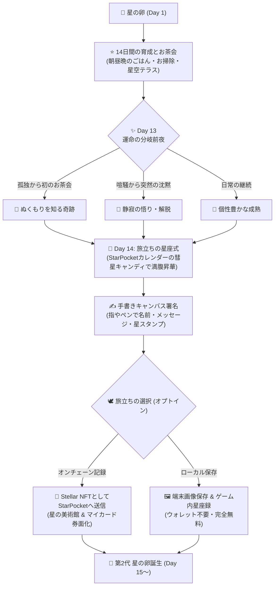
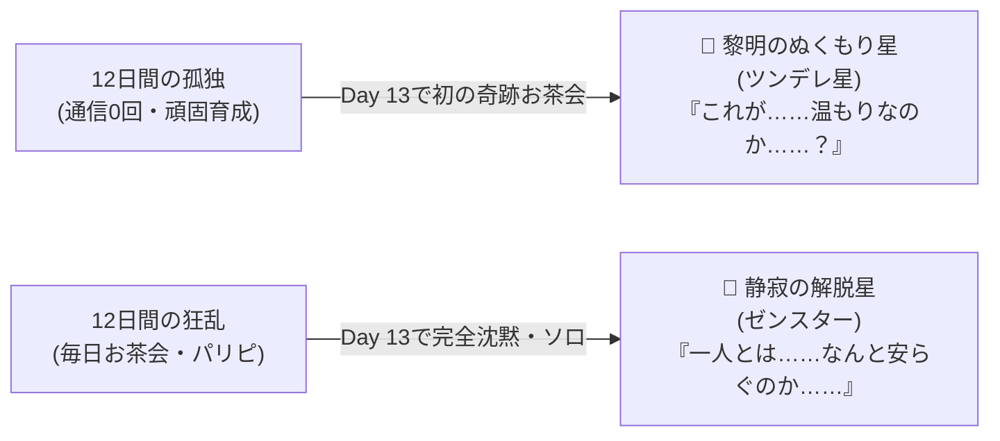
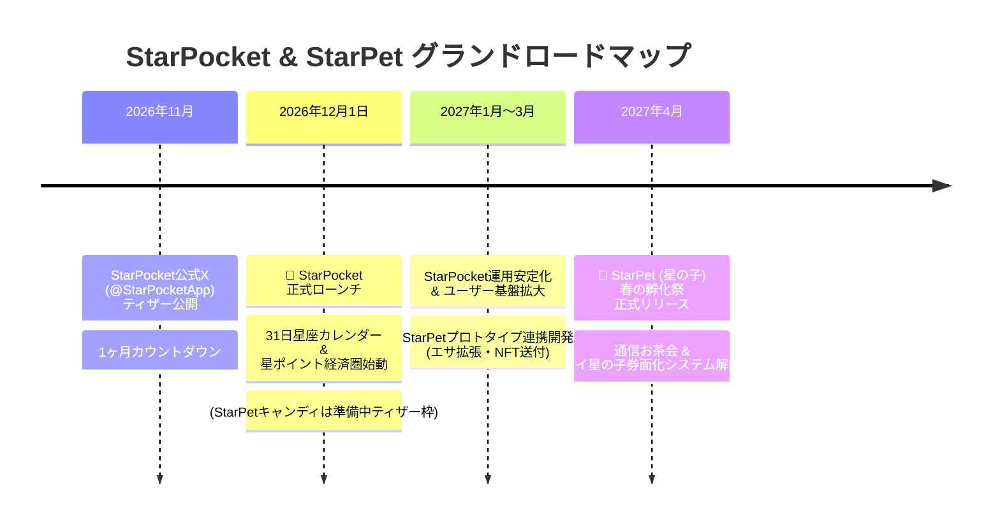

# 🐾 StarPet (星の子) ゲーム企画・詳細設計仕様書 (GDD)
**企画・原案:** お兄ちゃん (Mizuku) & ステラ (Lead Builder)  
**企画策定日:** 2026年10月29日  
**プロジェクトステータス:** Phase 2 プロトタイプ開発中（2027年4月 正式リリース予定）  
**連携プロダクト:** [StarPocket](https://github.com/mizukuhiiragi/starpocket) (Stellar TMA Smart Wallet)

---

## 1. エグゼクティブ・サマリー（世界観・哲学）

### コンセプト：『愛と生活リズムがそのまま星座になる、世界で一番やさしいWeb3ペット』
従来のGameFi（Play-to-Earn）が抱えていた「投機・金儲け・疲弊する周回」のプレッシャーを100%排除。  
90年代の初代たまごっちやデジタルモンスターの郷愁をまとう**16×16白黒ドット液晶風グラフィック**と、プレイヤーのリアルな日々の暮らし（朝ごはん、夜更かし、お茶会、静寂）がそのまま星の子の姿に宿る**「生活密着型・情操育成シミュレーション」**。

> **「資産価値はないけれど、私にとって世界一の宝物」**  
> 旅立ちの日、手書きでサインを添えた星座証書は、ブロックチェーンの星空へ昇華し、自分のスマートウォレット（StarPocket）のカード券面として一生手元に残り続けます。

---

## 2. コア・ゲームループ（14日間の黄金比）

* **1世代 = 14日間（約2週間）:**
  * 初代たまごっち（約14〜20日）の心理的黄金比を採用。短すぎて愛着が湧かないことも、長すぎて放置・罪悪感を生むこともない絶妙のサイクル。
  * StarPocketの31日カレンダー（Day 14: 彗星キャンディ解放）と完全同期。
  * 1ヶ月（約30日）でちょうど**2匹の星の子**が星座となってウォレットに届く心地よい月次コレクションリズム。

---

## 3. キャラクター進化マトリクス（生活リズム × 社交性）

本作には「失敗」「死亡」「ハズレ進化」は存在しません。プレイヤーの毎日の生き方そのものが、魅力的な個性として開花します。

### ① 基本生活リズム分岐（朝昼晩のお世話パターン）

| 進化形態 | 主な育成条件 | 外見＆性格 | プレイヤー像 |
| :--- | :--- | :--- | :--- |
| **優等生まめ星** ⭐ | 朝昼晩の定時ごはん・チリ（うんち）即清掃 | つるんと端正な正統派星型。礼儀正しくお辞儀する。 | 几帳面な朝型・ルーティンが得意な人 |
| **夜更かしネオン星** 🌙 | 朝抜き・夜遅くのお世話集中・夜型睡眠 | ナイトキャップを被り、紫やシアンのネオンに妖しく光る。 | 夜勤・クリエイター・夜更かし型 |
| **自立のマイペース星** 🛸 | お昼抜き（朝と夜のみ）・放置耐性強 | クールで自立心旺盛。ひとりで浮遊岩で読書している。 | 昼間仕事や学校で忙しい社会人・学生 |
| **ぽっちゃりモチモチ星** 🍡 | 満腹なのにエサ連打・キャンディあげすぎ | 丸々と太って弾む（くちぱっち枠）。いつも何か食べてる。 | ついつい甘やかしてごはんをあげちゃう人 |
| **星屑まみれのモップ星** 🧹 | 宇宙のチリ掃除をサボり気味 | 宇宙のチリを毛玉のように纏った愛され珍獣。愛嬌抜群。 | ちょっとズボラだけどマイペースな人 |

---

### ② 社交性・通信分岐（お茶会コミュニケーション）

| 進化形態 | 主な育成条件 | 特徴・エピソード |
| :--- | :--- | :--- |
| **孤高の頑固星 (おやじっち枠)** 🍵 | **14日間、完全ソロ育成 (通信0回)** | 宇宙の片隅で腕組み。「ふっ、宇宙は元より孤独なものさ…」 玄人プレイヤーが愛好する哀愁と大人の渋み枠。 |
| **爛漫のパリピ星 (太陽枠)** 🎉 | **高頻度で友達と星空テラスお茶会** | 全身から強烈なオーラを放ち、ピョンピョン飛び跳ねる。 「みんなだ〜いすき！宇宙パーティーしよっ⭐」 |

---

### ③ 伝説のドラマチック隠しルート（Day 13の転機）

1. **【Day 13の奇跡】〜黎明（れいめい）のぬくもり星（ツンデレ星）〜**
   * **条件:** 12日目まで徹底して孤独に育てた後、旅立ち前日の13日目に初めて誰かとお茶会をする。
   * **演出:** 頑固な殻を破り、うるうると目を潤ませて優しい光を放つ。「お前と出会えて…よかった…⭐」
2. **【Day 13の静寂】〜静寂の解脱星（ゼンスター・SNS疲れ出家ルート）〜**
   * **条件:** 12日目まで毎日友達と騒いだ後、13日目に突然連絡を断ち、完全な沈黙の中に座る。
   * **演出:** 喧騒の果てに孤独の心地よさを悟る。ドット絵があぐらを組んで空中浮遊し、頭上に後光が射す。「喧騒の彼方に、真の静けさを見出だしたぞ……合掌🙏」

---

## 4. StarPocket × StarPet エコシステム連携仕様

### ① 究極の「マイ星の子・カード券面化」システム
レアペットだけに価値を限定せず、**「日々一緒に暮らしたすべての星の子」**がウォレットの顔になれます。

* **ウォレットが『思い出のアルバム』に進化:**
  * 昇華式を終えた星の子の手書き星座証書は、StarPocketの設定メニュー「歴代星の子券面」に即時追加。
  * `[第1代] ポチ星 (2027/4/14 旅立ち)`、`[第2代] コメット星 (2027/4/28 旅立ち)` のように、いつでも過去の子をウォレットのメインカードとして着せ替え可能。
* **レア種・隠しルートの特典:**
  * 幻のレア種やDay 13隠しルートを成し遂げた子は、カード券面に**「虹色オーロラ発光枠」**や、カード上部に**`👑 ZEN MASTER`** 等の専用称号バッジが付与。

### ② NFT化の任意選択（オプトイン）
* **【A】オンチェーン星座NFTとしてStarPocketに刻む (0.00001 XLM):**
  * StellarブロックチェーンにメタデータとIPFSハッシュを恒久記録。ウォレットの「星の美術館」棚に永久収蔵。
* **【B】ローカル記念証書として画像保存 (完全無料・ウォレット不要):**
  * クリプトに触れたくない人でも、手書き入りの高解像度PNG画像を端末の写真フォルダにダウンロード可能。ゲーム内の「星座録」にも無料保存。

---

## 5. 通信＆ブリーディングシステム（星空のテラス）

* **星空のテラス (Cosmic Tea Party):**
  * Telegramのチャット機能を生かし、メッセンジャー上で招待リンク（`t.me/starpet_bot?tea=...`）を送るだけでマッチング。
  * 宇宙の青白いテーブルで2匹の星の子が並んで温かい星のお茶をすする平和な交流空間。
* **星のブリーディング（たまご誕生）:**
  * 親密度の高い友達とお茶会を重ねると、ファンファーレとともにお互いの画面に**「次世代のたまご 🐣」**が誕生。
  * 親のドット絵の色や星の突起数などが遺伝的に受け継がれる。
  * 「たまご産ませたいからスタポケ入れてみて！」という自然な招待（オーガニックバイラル）の原動力となる。

---

## 6. 技術スタック＆ロードマップ

### 技術構成
* **クライアント:** 超軽量 HTML5 Canvas + Vanilla JS（容量500KB未満、旧型スマホでも爆速動作）
* **オーディオ:** Web Audio API 8-bit シンセサイザー（ピコピコ音をリアルタイム波形生成）
* **ブロックチェーン:** Stellar Network / Soroban Smart Contracts (Gas: 0.00001 XLM)
* **連携プロトコル:** TMA Deep Linking (`t.me/starpocket_bot` ⇄ `t.me/starpet_bot`)

### ロードマップ

---
*Documented by Stella (Lead Builder) & Mizuku, October 2026.*
